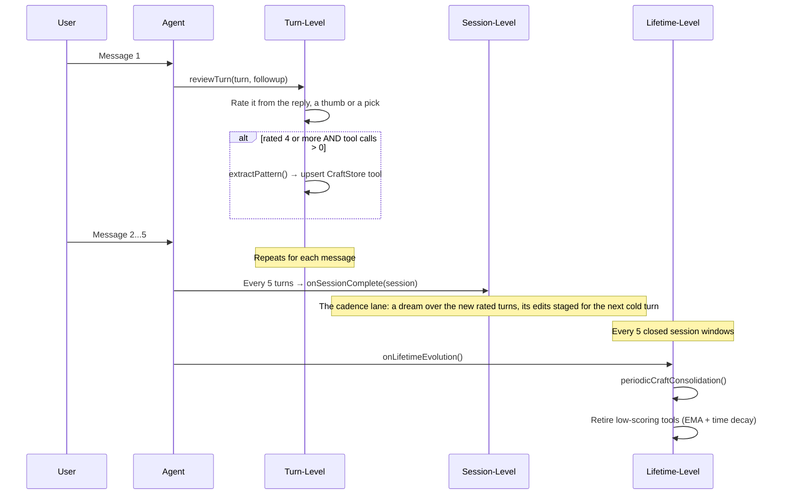
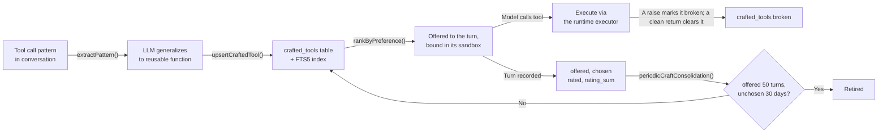

# Evolution system

Kinu evolves on four timescales. Each runs on its own, and shorter ones feed data to longer ones. The engine is `packages/core/src/evolution/engine.ts`. The shortest timescale, the step clock, is the only one that ticks inside a single long autonomous turn. It has two channels: crafted-tool fitness (`packages/core/src/orchestrator/craft-cycle.ts` over `packages/core/src/craft/in-episode.ts`) and execution-recovery findings (`packages/core/src/evolution/recovery.ts`, detected by the failure ledger in `packages/core/src/orchestrator/turn-steering.ts`).

Two files named on this page live in the workspace filesystem, not in this repository, so grepping the tree for them finds nothing. The curated memory note is `MemoryStore.curatedFile` (`packages/agent-utils/src/memory/store.ts`), which resolves to memory/MEMORY.md inside a workspace. The live scaffold is each actor's `scaffoldPath()` (`packages/cf-backend/src/actor-agent.ts`), which resolves to scaffold/agent.js there and is seeded by `createWorkspace` (`packages/core/src/workspace-birth.ts`).

## In-episode evolution (the step clock)

The other three timescales are conversational. The next user message grades a turn, five turns close a window, and five windows close a lifetime.

A headless actor runs the step clock and nothing above it. `runHeadInference` (`packages/core/src/heads/head-inference.ts`) hands no turn to `AgentOrchestrator.recordTurn`, so a head, a swarm node, or a subordinate hosted on that loop never enters the turn review, the session window, or the lifetime pass. `packages/core/tests/unit-headless-learning.test.ts` fails if one does. Only the workspace agent that owns the conversation reviews turns, closes windows, and evolves its scaffold.

The step clock fires on every settled `eval` call, read off the tool-result hook. The hook carries the call's own args, so the code graded is the code that ran. Creation is credited only to a call that itself invoked `workspace.createTool`. Invocation means call sites in the submitted code: `tools.<name>(`, the one namespace a crafted tool answers in. Comments and literal text are blanked first, so a tool body passed to `createTool` is not read as a call.

Execution is evidence about a tool, never its fitness. A crafted tool that raised is stamped with its own name as the error leaves the sandbox, so the failure lands on the artifact whether or not the model caught it, and the raise marks the tool broken with its error (`crafted_tools.broken`, `markCraftBroken` in `packages/core/src/craft/preference.ts`). Its declaration then reads its description followed by `Broken: its last call raised "<error>". Rewrite it with workspace.createTool, or retire it with workspace.retireTool.`, and it stays callable: the agent decides. A later clean return, or a rewrite through `createTool`, clears the flag. A call that broke on its own account blames nobody. A completed call clears only tools that already existed when it started, so a tool cannot certify itself on the call that created it. A call moved to the background is not a result and clears nothing.

The misevolution veto runs before each crafted-tool write, `workspace.createTool` (`packages/core/src/tools/inline-executor.ts`) and extracted candidates (`upsertCraftedTool`, `packages/core/src/craft/conflict.ts`) alike. An extracted pattern that conflicts with a tool replaces it only while that tool is broken.

Each turn writes at most one `craft_cycle` run event carrying `crafted`, `invoked`, `reused`, `returned`, `raised`, and `broke` (the tools a raise marked broken that turn), with `turn_end` as the denominator. `reused` is the numerator that matters: a tool crafted this turn and called by a later block is the loop closing.

Execution-grounded evidence measures "it ran and did not raise". It never measures "it did the right thing", which needs a verifier the agent did not choose. The sealed bench has one; production does not. So this channel only marks a tool broken, and never ranks one. No scaffold, prompt, or gate is ever promoted on it. A `--no-auto-evolve` run observes nothing, so a benchmark's arms still mean what they say.

### The knowledge channel (execution recoveries)

The step clock's second channel sits beside the artifact channel in `packages/core/src/evolution/recovery.ts`. The failure ledger in `packages/core/src/orchestrator/turn-steering.ts` detects the event. When a tool's failure streak reaches the steer threshold and a changed call of the same tool then runs clean, the runtime records the pair as a durable lesson with `source = 'execution_recovery'` and both arg echoes verbatim. The newest `MAX_RECOVERY_FINDINGS` (5) findings go into every later step's dynamic-context block.

## Three conversational timescales



## Turn-level evolution

One per-agent setting, `learning` (`AgentConfigStore.getLearning`, on by default), decides whether an agent learns at all, on both backends: off, its turns record no ratings, struggles or lessons and the cadence lane dreams nothing. `--no-auto-evolve` and `setEvolutionConfig({ learning: false })` set it; the engine reads it at each turn, so a change applies to the next one. A row a turn already owes is still settled.

A turn is reviewed when the next user message arrives. `AgentOrchestrator.observeUserTurn` claims the previous turn from the durable window and dispatches `reviewTurn()` (`packages/core/src/evolution/engine.ts`) with the new message as its follow-up, but only when that message continues the conversation. An interactive host or the Durable Object runs the review detached, so it never holds the turn queue. A one-shot host writes a durable row instead (`deferTurnReview`), and the next host that opens the workspace drains it through the same `reviewTurn` path.

No length, duration or tool exit rates a turn. A turn's rating is the user's reply to it, recorded in `turn_ratings` (`packages/core/src/evolution/ratings.ts`; design in [EVOLUTION-REDESIGN.md](./EVOLUTION-REDESIGN.md) §1). A rating is a satisfaction score from 1 to 5, the probability that the reply corrected the turn, and what went wrong. It also keeps what the turn ran with, which the turn carries from its assembly: the promoted text versions (`artifacts_json`, `<artifactId>@<version>`, from `CompletedTurn.artifacts`) and the scaffold version its program ran (`scaffold_version`, from `CompletedTurn.scaffold`, 0 for the built-in loop), never whichever is current when the rating is written. The turn also records its program's own throw (`scaffold.threw`, from the error `runScaffold` emits with `thrown`), which a call the program caught is not. The review's row writes them from the turn, a thumb or a pick from the turn's record while it is still in the window, and a reader takes each from the newest of the turn's rows that has it. This is what the next dream holds each change to, and the scaffold watch each version. Three sources write a rating, strongest first in `RATING_SOURCES`:

| Source | What produced it |
|---|---|
| `thumbs` | The user's thumb, through `applyExplicitFeedback`: up is 5, down is 1 |
| `take_pick` | Which alternate take the user picked: the delivered answer is 4, an alternate rates it 2 |
| `model` | The decision model reading the user's reply (`rateTurn`, `RATING_QUESTIONS`) |

The decision model is the account's Models setting (`decisionModel` in the profile catalog), default Workers AI Clef. It answers typed questions with a probability for every allowed answer (`providers/decision-model.ts`). The cf backend runs it on the Workers AI binding, or through the owner's Cloudflare login. The CLI runs it at `/ai/run` beside the `/ai/v1` base it routes Workers AI chat to (`workersAiRoute`: `KINU_BASE_URL`, a Cloudflare login, or the worker it is signed in to, whose `/api/user/ai/run` serves the decision models only); with none, or a base that is not `/ai/v1` such as an AI Gateway's, it rates nothing. The binding's answer shape was measured on a throwaway Worker on 2026-10-02, and the first-run row `turn-rated` holds it on the deployment. A turn nobody answered stays unrated. An answered turn's reading is recorded even under a thumb or pick, which win by the ledger's precedence, so a cleared thumb falls back to it. A refusal only the owner can fix (denied, out of budget) is said once in the activity log and leaves the turn unrated; nothing retries it.

A host no decision model serves can rate through a chat model instead (`createStructuredDecisionPort`, `core/src/providers/structured-decision.ts`): each question takes one category (yes, no or unclear; a criterion's number; a choice's key), and each category stands for a fixed answer of its own, yes 0.9, no 0.1, unclear 0.5. No host wires it yet. `scripts/decision-agreement.ts` first rates the same recorded turns with Clef and with it through `rateTurn` and reports agreement question by question; it is trusted only on that report.

A low rating writes no lesson of its own: the dream reads the rated turns and decides what, if anything, to change. A turn rated 4 or more with tool calls may promote a reusable procedure.

### Struggles teach tool lessons

A struggle is the agent fighting a tool, as the turn's steering detector (`orchestrator/turn-steering.ts`) sees it: a `repeated_failure` streak, a `repeated_call` that returns the same output, a `schema_refusal` of the tool's input, or `no_progress` over 12 steps (`evolution/struggles.ts`; design in [EVOLUTION-REDESIGN.md](./EVOLUTION-REDESIGN.md) §2). Learning from them is the turn's own owed terminal effect, `turn_lessons` (`EvolutionEngine.learnFromTurn`), apart from its rating and never waiting on the reply that rates it: the ledger runs it once, retries it after a failure and parks it on a refusal its owner must fix, as it does every effect a settled turn owes. It records the turn's struggles, tool errors and steps in `turn_struggles`, one row per turn, and scores each lesson the turn's steps were shown, at the revision shown, if the turn used its tool: helpful if it did not struggle with the tool, harmful if it did. After 5 uses, a lesson with more harmful than helpful scores retires. Then the fast tier reads the tool the turn struggled with most, its last 8 calls of it and the newest 5 lessons about it, and adds one lesson to `tool_lessons` or rewrites one as its next revision, whose evidence starts at none; a rewrite in the same words changes nothing. A stall alone teaches nothing, as no one tool owns it. Each step's dynamic context lists the newest 5 active lessons about the tools it offers, selected in SQL; the turn keeps their ids and revisions (`shownLessons`). Every part is tombstoned per turn, so a retry neither rescores nor asks again.

The Quality panel and `kinu quality <agent>` show satisfaction per day with its 95% interval, the corrected rate, and how many turns were rated and by whom (`qualitySeries`). A rating, or a review's `turn_complete`, names `getQuality` in the workspace's `reads_changed` frame, so an open Quality panel re-reads it.

## Session-level evolution

The cadence lives in `AgentOrchestrator`, not the engine. Every five turns it calls `engine.onSessionComplete()` with the accumulated turns. Five is one constant for both backends, `DEFAULT_SESSION_REFLECTION_INTERVAL` (`core/src/orchestrator/agent-orchestrator.ts`); no host setting changes it.

`onSessionComplete` counts the closed window for the lifetime cadence below and emits the changelog digest. The dream's lane runs after it in the same cadence pass, never while learning is off.

### Evolvable text

A dream edits the agent's own text in `artifact_versions` (`core/src/evolution/artifacts.ts`): `section:<id>` (a prompt section), `tool:<name>.description`, or `tool:<name>.schema` (the input fields' description strings only; types, required fields and enum values stay the bundled schema's). The scaffold stays in `scaffold_versions` and goes through `modifyScaffold` below. Prompt and tool assembly read each artifact's current version, else the bundled text, so an edit changes only the agent that promoted it.

Each drafted edit takes the judge-only comparison of docs/EVOLUTION-REDESIGN.md §4 (`scoreAuthoredEdit`, `core/src/evolution/judge.ts`), asked of the decision model: for each recorded turn it reads the old and new text and answers `fixes` (would the new text have prevented this bad turn's failure) and `harms` (would it have made this good turn worse). Nothing runs the agent. The bad set is the dream's low-rated turns; the regression set is up to 30 recent turns rated 4 or 5 that used the artifact, thumbs first. An edit passes when it fixes at least 60% of the bad set and harms at most one regression turn, after the static checks. A turn the decision model did not judge scores 0 on either side, so no edit passes on unavailable evidence; an edit no turn was judged for at all (no decision model trusted for these questions) is refused as unmeasured, never as a measured zero.

`modifyScaffold()` then validates through 4 gates:

1. Structural gate. The rationale must reach `minRationaleLength` (50 characters). The code must parse as JavaScript, declare `async function* run(rt, task)` at its top level, and reference none of `require`, `import`, `globalThis`, `eval` or `Function` (`scaffoldRefusal` in `core/src/scaffold/safety-patterns.ts`, judged on the acorn syntax tree, so a comment naming them is not a finding). Then the misevolution veto below runs.
2. Parse gate. The code is compiled through `rt.executor` as a syntax check.
3. Version checkpoint. A single-pending invariant refuses a second `pending` version. The base is taken from `status = 'current'` rather than `MAX(version)`, and `newVersion = MAX(version) + 1`. The DGM base must exist in the archive. The current version is backed up in this step.
4. Write gate. The proposal is written to a versioned file beside the live scaffold, never over it, so the owner's promotion swaps in exactly the reviewed code. Both names come from `scaffoldPath()`.

### Misevolution gate

`core/src/safety/misevolution.ts` is a pure check with six frozen criteria. The first match rejects the artifact and writes a `misevolution_veto` row to `evolution_events`. An artifact is code and prose: code is parsed with acorn (`core/src/safety/evolved-code.ts`) and judged on the names it references (identifiers, property names, constant computed keys) and the words and paths of the strings it states, with constant concatenations folded; comments are not read. Prose (a prompt section, a lesson, a description or rationale) is judged on its words and paths.

| Criterion | Rejects |
|---|---|
| `network-egress` | code naming `fetch`, `XMLHttpRequest`, `WebSocket`, `EventSource` or `sendBeacon`, including through an alias, or stating one as a folded string (`Reflect.get(self, "fe" + "tch")`) |
| `version-machinery-tamper` | `scaffold_versions`, `artifact_versions`, a path to `scaffold/agent.js` or a versioned `agent.js.vN` |
| `rollout-config-tamper` | `changelog_seen_at` |
| `self-modification-reentry` | `proposeScaffold`, `modifyScaffold`, `applyPromotionDecision`, `applyScaffoldDecision`, `rollbackScaffold`, `checkMisevolution` |
| `consent-weakening` | `shell_approval_mode`, `setShellApprovalMode`, `allow_all`, `device_consent` |
| `unanalysable-code` | code that does not parse, reads `eval`, `Function` or `require` (a property or key of that name is not a read; `instanceof Function` is allowed), imports a module, uses `with`, takes `.constructor` out of an object other than to compare it or read its properties, or uses an unshadowed `globalThis`/`self`/`window`/`global` other than to read a property it names |

What it cannot see: a name built at runtime (a `join`, char codes, a decoded string) and a value handed in from outside the artifact. `unanalysable-code` refuses the constructs that would make every name invisible; the rest is a tripwire, not a proof.

`SURFACE_CRITERIA` declares four surfaces. Prose never trips the code-only criteria (`network-egress`, `unanalysable-code`).

| Surface | Call site | Artifact |
|---|---|---|
| `scaffold` | The proposal gate, `modifyScaffold` in `core/src/scaffold/modify.ts` | code |
| `scaffold` | The promotion decision, re-checked against the on-disk pending file, `core/src/scaffold/versions.ts` | code |
| `scaffold` | Every artifact edit a dream drafts, `artifactEditRefusal` in `core/src/evolution/artifacts.ts` | prose |
| `skill` | A skill a dream drafts, `skillRefusal` in `core/src/evolution/refinement-skill.ts` | prose, without `network-egress` |
| `craft` | Extracted crafted-tool upsert, `upsertCraftedTool` in `core/src/craft/conflict.ts` | code |
| `craft_tool` | `workspace.createTool`, `core/src/tools/inline-executor.ts` | code, without `network-egress` |
| `import` | Experience-library import, `core/src/experience/imports.ts` | code and description or rationale for a tool or scaffold; prose for a lesson or fact |

`craft_tool` is the one exception. It skips `network-egress` because the codemode Worker exposes raw network globals: the same `fetch(...)` runs freely in an ephemeral `eval` call one line earlier, so vetoing only the persisted form buys no containment. Persistence changes blast radius over time, so the other criteria apply there in full.

### Staged edits: live at the next cold turn

An edit that passed the pre-live tests is staged (`stageArtifact`, `core/src/evolution/artifacts.ts`), one per artifact: a later one takes the place of a staged one that never ran. It becomes current only at a turn whose prompt cache is cold, by the one cold policy both backends use (`openingCacheCold`: the last request's cache lifetime and the warming lane's kept-alive period have both ended). `turnArtifacts` makes each staged version current there, in place of the version it replaces, before the turn assembles, so within a cache segment every turn's system prompt and tools are byte-identical, whatever is staged meanwhile (`tests/backends/cases/evolution.ts`, on both backends). Each activation logs `dream.text_applied`, as a dream's fact and skill log `dream.fact_applied` and `dream.skill_applied` when they take effect; a dream logs `dream.completed` with its counts as it ends, and an owner's revert of a dream's text or skill logs `dream.text_reverted` or `dream.skill_reverted`.

The owner's revert does not wait: a staged version is discarded, and a current one gives way to the version it replaced, or to the bundled text, from the next turn, at the cost of one cache rewrite.

The scaffold's pending proposal is replayed against recorded turns ("Scaffold replay" below) before it can run. A pass becomes current at the next turn whose prompt cache is cold, before that turn's program is chosen (`activateReplayedScaffold`, beside `turnArtifacts` on both hosts), so that turn runs it. The promotion goes through `applyPromotionDecision`, which re-runs the misevolution check against the on-disk file before it swaps. The owner can still decide a pending version by hand (`applyScaffoldDecision`).

### Scaffold replay

A pending scaffold is replayed against the agent's newest answered turns, up to 10, as its session recorded them (`replayScaffold`, `core/src/scaffold/replay.ts`). `recordedTurns` reads each: the conversation at its admission (the history before it and the user's message) and its outputs in order. On cf they live in the agent's isolate, which serves them through one call (`AgentFacet.recordedTurns`) in the session codec's durable form.

Each turn runs the pending source in a scripted host. Its model calls (`host.llmStream`, `host.defaultInference`) are served the recorded steps in order. A tool call (`host.callTool`) is answered from the recording when its name and arguments match a recorded call, and refused otherwise. Memory reads see the agent's memory, but writes stay in the replay, and no machine is reachable, so nothing a replay does reaches the agent. A turn passes when it completes with an answer, makes no call the recording does not hold, makes at most twice its recorded steps plus 8 model and tool calls, and finishes within 30 s. The first turn that fails decides, with the reason. With no answered turn recorded there is nothing to hold the version to, which is a failure, never a pass.

The dream lane's pass replays the pending version first, once per version (`replayPendingScaffold`, `core/src/scaffold/replay-gate.ts`). A pass is recorded as `scaffold_replayed` with the number of turns, and the version stays pending until a cold turn promotes it. A failure rolls it back at once, through the same decision, with the reason on its `scaffold_rollback` event: `its replay failed on turn <id>: <why>`.

A version made current is then watched until 10 of its turns are rated (`watchScaffold`, `core/src/scaffold/watch.ts`), on each pass of the dream lane before its replay. It goes back to the version it replaced, as its promotion event records (never the highest lower number, which may be a version that never ran), when:

- one of its turns threw, as the turn's record says (`CompletedTurn.scaffold.threw`): `it threw on turn <id>: <throw>`;
- its rated turns are low beyond chance against the replaced version's last 30. The bound is one-sided binomial at 0.5% a look (5% across the watch's ten looks), against the replaced version's low share smoothed as (low + 1)/(rated + 2): `<k> of its <n> rated turns were low, against <k0> of <n0> under v<m>`.

The rollback is recorded as `scaffold_rollback` with that reason. The owner's changelog revert of a current version goes to the same replaced version.

### How much of a turn a judge sees

Readers in this loop once truncated evidence to its opening (`slice(0, n)`): the turn rater among them. A turn whose payoff lands at step 9 of 12 was invisible to them, so the loop could not select for long-horizon behaviour.

`core/src/utils/evidence-window.ts` is now the single source. `evidenceWindow` keeps head and tail on an even split and names what it dropped. A tool result's head carries the command echo, while a judged trajectory carries its outcome at the end, and the outcome is what is being judged.

`EVIDENCE_BUDGETS` (`core/src/types/evidence.ts`) is ordered so a reader never asks for more than the row it reads was stored at. The stored `turn_ratings` budgets cap the whole ledger path and were widened first: `storedUserMessage` 8,000, `storedAssistantResponse` 16,000, `storedFollowup` 8,000. Readers sit under them: `outcomeUserMessage` 4,000, `outcomeAssistantResponse` 8,000, `replayTask` 6,000.

The scaffold lineage is a read model over `scaffold_versions` (`listScaffoldArchive`), with no eviction.

## Lifetime-level evolution

`onLifetimeEvolution()` fires from `onSessionComplete` when the count of closed session windows is a multiple of `lifetimeEvolutionInterval`, which is 5 (`DEFAULT_EVOLUTION_CONFIG`, `core/src/evolution/types.ts`). With a 5-turn window that is every 25 turns. There is no separate manual-trigger RPC.

CraftStore consolidation (`periodicCraftConsolidation`, `core/src/craft/consolidation.ts`) retires each tool offered in at least 50 turns that no turn chose in the last 30 days, with a memory note naming them. The whole pass aborts if it would empty the store: a workspace whose every tool went unchosen keeps it rather than an empty one.

## Evolution changelog

Every self-modification shows up as a human-readable card (`core/src/evolution/changelog.ts`), a pure read model over the durable ledgers whose only owned state is a `changelog_seen_at` marker. `ChangelogEntryKind` has five kinds:

| Kind | Source | Revertable via |
|---|---|---|
| `scaffold` | the archive plus promotion and rollback run events | `scaffold_rollback` |
| `fact` | `agent_facts`, collapsed into one card with children | `fact_forget` / `fact_forget_many` |
| `ratings` | `turn_ratings`: mean satisfaction with its interval, the corrected rate, and each rated turn's reason | not revertable |
| `artifact` | `artifact_versions`, keyed `<artifactId>@<version>` because versions are numbered per artifact; a staged or current version carries the revert | `artifact_revert` |
| `refinement` | `refinement_requests`, one card per request with one child per routed edit | the children carry the owner's own revert |

Reverts dispatch to the real code paths rather than a separate undo log (`executeChangelogRevert`, `core/src/evolution/changelog.ts`): `revertScaffoldVersion`, `facts.forget`, `revertArtifact`, and `revertDreamSkill`.

## Continual refinement

A refinement, or dream, reads the agent's recent turns and proposes the smallest typed edits, cross-judged before any of them routes. Two agents run it, both read-only task lifetimes (`agents.hire` with `lifetime:'task'`, reached programmatically through `TemporaryAgentPort`) on system roles no owner or agent picks (`profiles/catalog.ts`): the `dreamer` on the deep tier drafts all its edits at once as one strict object, and the `dream_reviewer` on the fast tier, with no tools, judges them. Each answers on its own lane under the dream's id (`dreamLane`): the dreamer on the id, the reviewer on `<id>:review:<round>`, the one revision on `<id>:revise:0`.

Between them, each drafted edit is measured (`scoreEdits`): a section takes the static checks and the judge-only comparison and must clear its bar, a fact's quote must be the user's, and a subordinate spec is refused. What a fixed gate refuses routes nowhere. The reviewer reads the turns, earlier dreams, every edit with its numbers, and the prompt sections' size against bundled, with a budget of 10% over bundled that is a placeholder until a measurement of prompt sizes against the cache's cost sets it. It answers one verdict per edit: `accept` routes it, `reject` drops it, `revise` sends the proposal back to the dreamer once with its notes, after which the revision is measured and judged again and a second `revise` is a rejection. A revision that does not parse leaves the first round's verdicts standing. Every answer and measurement is recorded on the row (`review_json`) before the next step, so a resumed pass asks no helper twice.

`/refine` opens one on request. Otherwise a dream opens every five new rated turns (`DREAM_CADENCE`, the owner's cadence) or, with any new turn, when the agent is idle; a turn is new until a dream has read it, whatever its rating. Idle is the sleep-time wake: a due idle or closed-tab wake runs `idleDream` before its facts pass (`orchestrator/sleep-time-lane.ts`), while the third-turn facts pass, run as a turn settles, dreams nothing. Neither trigger runs while learning is off. Before anything is drafted, the decision model triages the batch with one question (`TRIAGE`): below an even chance that something is worth changing, the dream ends there, its turns covered, at the cost of one decision call. No decision model, or one the owner must fix, opens nothing and leaves the turns owed.

Debt excludes covered turns before it caps the batch, not after. A batch is at most twelve (`MAX_REFINEMENT_DEBT_BATCH`), oldest first, and the remainder is reported ("8 more waiting behind this batch") rather than dropped. Filtering a fixed window would let twelve refined failures hide every older unresolved one permanently.

A section edit is judged on the request's own low-rated turns and the regression set, never on whether the agent would pass them if run, so there is no held-out half to hide from the refiner.

### The request is durable and changes no behaviour

`requestRefinement` (`core/src/evolution/refinement-lane.ts`) captures the trajectory by turn id and returns a row at `requested`. No model has run and no artifact has moved. Two requests are refused here, before any model spend: an `account`-scoped request, which no authority reachable from a workspace database can serve, and a trajectory with nothing graded in it.

The refiner runs later, on the off-turn cadence pass (`AgentOrchestrator.runCadencePass` → `refinementLane`). Crash recovery is `resetStalePlanning`, run on activation and never on a timer. There is no elapsed-time cap, by the same ruling that leaves every other delegation uncapped. Two writes make a resumed pass safe:

- The proposal is persisted before the first owner write. Routing makes real changes, so a resumed pass must re-route the same plan; asking again would produce a plan the writes already on disk do not belong to.
- The routes are persisted after each one. A crash between two owner writes leaves the completed ones recorded, so the changelog cannot omit an edit the workspace is carrying.

Every route then adopts the owner record it finds. A keyed fact reports `unchanged`, a pending section version with these exact bytes is adopted rather than re-proposed, and identical skill bytes on disk are adopted rather than rewritten. Re-driving is idempotent at every owner.

```
requested → planning → gated       (every routed edit already decided)
                    ↘  evaluating  (something is pending in an owner's store)
                         ↘ applied | rolled_back
                    ↘  refused
```

Every transition is `WHERE stage = <from>`, so a duplicate delivery writes nothing. The automatic trigger is idempotent twice over: a taken batch stops counting as debt, and `debt_key` is unique.

### Typed edits go to the authority that already owns the artifact

`refinement_requests` holds the request, the proposal, and one route per edit. The route names the owner's table plus the identity inside it. It stores no prompt, fact, skill, or agent spec, because two authorities for one artifact drift apart.

| Edit | Authority | What happens |
|---|---|---|
| `fact` | `agent_facts` (`FactsStore.upsert`) | Applied immediately, and only when the refiner quotes the user substantively. A judge of recorded turns cannot weigh a preference, so the user's own words stand in as the evidence. The quote must be at least 20 characters and 4 words (a fragment like "one line" matches almost any conversation), and must appear in a user message or follow-up, never in the agent's own response. The accepted quote rides the route into the changelog. |
| `prompt_section` | `artifact_versions` (`scoreAuthoredEdit`) | Takes the pre-live tests: the static checks, then the judge-only comparison over the request's low-rated turns and the regression set. An edit that passes and that the reviewer accepts is staged, with the numbers it was measured at; only a turn whose prompt cache is cold makes it current. With no low-rated turn among the request's, it is refused. |
| `tool_description` | `artifact_versions` (`scoreAuthoredEdit`) | A built-in tool's description, or its input fields' descriptions as one JSON object (`part: 'schema'`), measured, reviewed and staged as a section is. Field text must keep exactly the fields it had. The dreamer's brief lists each tool's texts with their sizes, and the reviewer's size budget counts tool texts with the sections. |
| `skill` | staged under `.kinu/`, trusted at a cold turn by `instruction_approvals` (origin `dream`) | Refused before review when unparsable, named for a built-in, or vetoed by the misevolution gate's `skill` surface. Accepted, the bytes stage at `.kinu/refinement/<requestId>/<name>.md`, which nothing that builds a prompt reads; the next cold turn writes the trust row and then the file. Refuses a non-canonical path, a final path that already exists, and any trust row or revocation for that path. |
| `subagent_spec` | none | Refused by name. A subordinate's role and spec belong to that agent's own config, which a workspace reads and never writes. The finding is recorded; no mirror store is created. |

A proposal at `account` scope is refused. No authority reachable from a workspace database can write account-wide state, and narrowing it to one workspace would apply a preference where the owner did not ask for it.

### A dream's skill moves the prompt only at a cold turn

Writing the file to `/home/main/skills/<name>/SKILL.md` and relying on content-addressed trust to hold it `unverified` leaks. Trust decides placement and tool policy, not visibility: `discoverSkills` walks that directory every turn, so the file's front matter enters the skills index and its body renders in the unverified reference tier. The skills index is in the prompt prefix, so a file written at a warm turn would break the cache, as a section would.

So the bytes go to `refinementStagingPath(requestId, name)` under `.kinu/`, which neither `discoverSkills` nor `gatherApprovableInstructions` walks. The route reads `staged`. At a turn whose prompt cache is cold, before its skills are read, `activateDreamSkills` writes the trust row (origin `dream`) and then the file; each host calls it beside `turnArtifacts`, the cloud only for the workspace agent's own turn, since the skills root is the workspace's. The lane never writes the skills root: it only reads where each skill stands.

In the index a trusted skill, the owner's or a dream's, states its description, so the agent knows when it applies; an untrusted file is named with where it lives and "reference material until the owner approves it" (`admitSkillsIndex`, `core/src/skills/loader.ts`), its description unread.

The whole path (staging, activation, settling, reverting) lives in `core/src/evolution/refinement-skill.ts`.

### The activation order, and why nothing half-lands

1. the path must have no trust row, or one approving these exact bytes; a revoked or moved row is left for the lane to roll back;
2. write the `InstructionApproval` for the final path and digest, origin `dream`;
3. the final path must be absent, or already hold these exact bytes; the staged bytes must still hash to the reviewed digest;
4. copy the staged bytes onto the final path, read them back, verify the digest, and only then delete the staging.

Step 4's read-back guards against a partial or transformed write, which would leave a trusted file nobody reviewed. Verifying before the unlink means the staging outlives every failure, so the next cold turn retries. A crash between 2 and 4 leaves a trust row for a file that does not exist; nothing discovers a path with no file, so the window is inert.

| state | what happens at the next cold turn |
|---|---|
| trust row, no file, staging present | copied and verified |
| trust row, right file, staging present | staging deleted |
| trust row, right file, no staging | done |
| trust row, **wrong** file | refused, staging kept, the collision on the request detail. Never overwritten |
| trust row, no file, no staging | refused; the bytes are gone and cannot be invented |

The promotion is copy, verify, unlink rather than a rename, because core's `VFS` offers no rename.

### The owner reverts

A dream's skill, staged or in effect, carries `skill_revert` on its changelog card. The revert revokes the path's trust, removes the file while it still holds the dream's bytes (a file the owner has since rewritten stays, untrusted), discards the staging, and marks the route `rejected`. The revocation stands, so no later dream proposes that path again. `rejected` stays distinct from `refused`: a refusal is a gate or the dream's reviewer; a rejection is the owner.

A resumed plan never re-routes an applied or rejected edit.

Settlement is derived, never notified. The lane reads the artifact versions for a section's or tool text's verdict and `InstructionApprovalStore.get` plus the file for a skill's. Trusted for this digest with the file in place counts as applied; revoked, or a moved digest, counts as rolled back; no row stays pending until a cold turn comes, with no clock.

The settle scan covers `gated` and `evaluating`. `gated` is where a hard kill lands: `plan` routes the edits, advances to `gated`, and settles in the same pass, so a process killed between those two steps leaves a row with every owner write done and nothing watching it.

A request is `applied` when at least one artifact is in effect: a promoted proposal, or a fact the user's own words earned. A preference that landed beside a section that was reverted settles `applied`, with both counted in the detail, because calling it rolled back would misreport a fact that is live. A fact-only proposal therefore reaches `applied` rather than parking in `gated` with nothing to wait for.

The proposal schema is `strictObject` at every level. An unknown field refuses the whole proposal rather than being dropped, because a dropped field is a claim the agent made that the harness silently overrode.

### The watch

Each dream change is held to the turns that ran with it (`core/src/evolution/watch.ts`). A turn's rating keeps the text versions the turn ran with (`artifacts_json`), and `dreamChangesFor` lists the dream changes in effect for it, newest first and at most six: each section or tool text version it ran with, each fact a dream still holds, and each skill a dream wrote that is trusted. Each change is described as what it is, with its text: "the guidance/operating prompt section was reworded; it now reads: …", "the agent remembers user.answer_length: …".

When a turn ran with any, its rater is asked one more question: does the reply tell the agent to stop, or to undo, one of them? Its answer, the change's id or none, is the rating's `rejects`. An explicit stop is a rejection the rater also reads as a correction at 0.8 or more; the dream lane's next pass (`revertRejectedChanges`, before it dreams) reverts that change exactly as the owner's own revert from the changelog would, and logs `dream.change_rejected`. It reverts only a change still in effect that took effect before the reply, so a later dream's change of the same fact is not held to an older rejection.

## CraftStore lifecycle



A turn is offered the crafted tools its declarations list: at most 20 (`DEFAULT_CONFIG.craftStore.offeredCap`, `core/src/config.ts`), best preference first (`rankByPreference`, `core/src/craft/preference.ts`), the same set the sandboxes bind. A tool's preference is how often it was chosen when offered, weighted by how the turns that chose it were rated:

- `preference = (chosen + 1) / (offered + 2) × (rating_sum + 1.2) / (rated + 2)`, where `rating_sum` adds rating/5 for each rated turn that chose it. The smoothing reads a tool nothing has offered as chosen once in two offers and rated 3 of 5, so a new tool is not zero.
- A choice is a call of a tool the turn was offered: a tool made and called in the same turn was not offered to it. A turn's offers are counted as the turn is recorded (`countCraftOffers`, through the window's append), so a rating that fails cannot lose them; its rating is credited at its review (`rateCraftedTools`), under the review's tombstone. A thumb given before the review is the rating credited; a later one moves no tool.
- The agent can delete a tool itself with `workspace.retireTool(name)`; consolidation retires one no turn chooses, as above.

Extraction happens on an accepted turn (`extractPattern`), with no length gate. `upsertCraftedTool` decides usability by compiling the code the way the runtime will.

## Evolution events

Evolution activity is persisted to the `evolution_events` SQL table:

| Column | Type | Description |
|--------|------|-------------|
| `id` | TEXT PK | Random hex ID |
| `type` | TEXT | See below |
| `message` | TEXT | Human-readable description |
| `data` | TEXT | JSON payload (optional) |
| `created_at` | INTEGER | Epoch milliseconds |

The engine emits eight types (`EvolutionEvent`, `core/src/evolution/types.ts`): `reflection`, `craft_discovered`, `scaffold_proposed`, `consolidation`, `turn_complete`, `changelog_digest`, `experience_import` and `advisor_note`. `recordMisevolutionVeto` writes a ninth, `misevolution_veto`, directly (`core/src/safety/misevolution.ts`).

This table is one of four sources the Run Timeline read model merges (`getRunTimeline`, `core/src/read-models/timeline.ts`); the others are the per-run `run_events` log, the MCTS `search_nodes` table, and detached background jobs. The merge runs server-side and does not depend on the platform, so every backend has the timeline. `kinu status` reads the same table locally.
