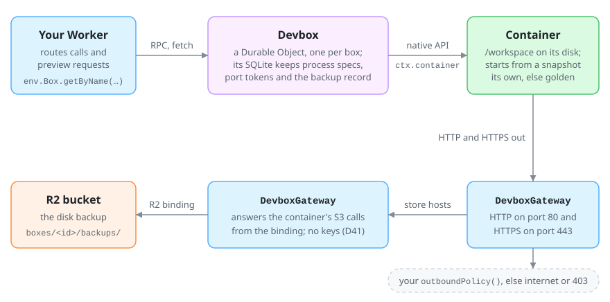
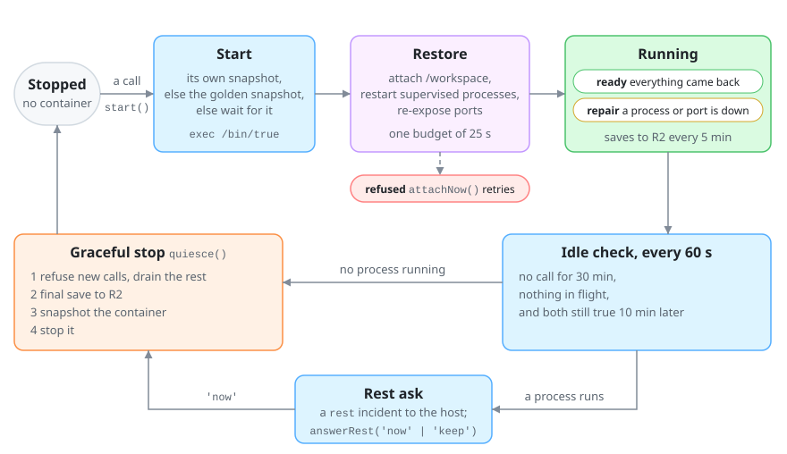
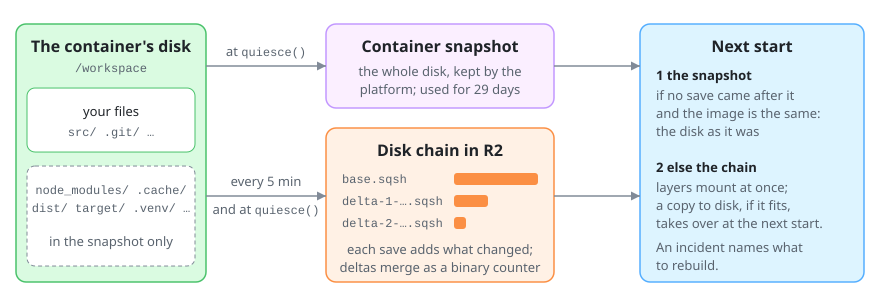
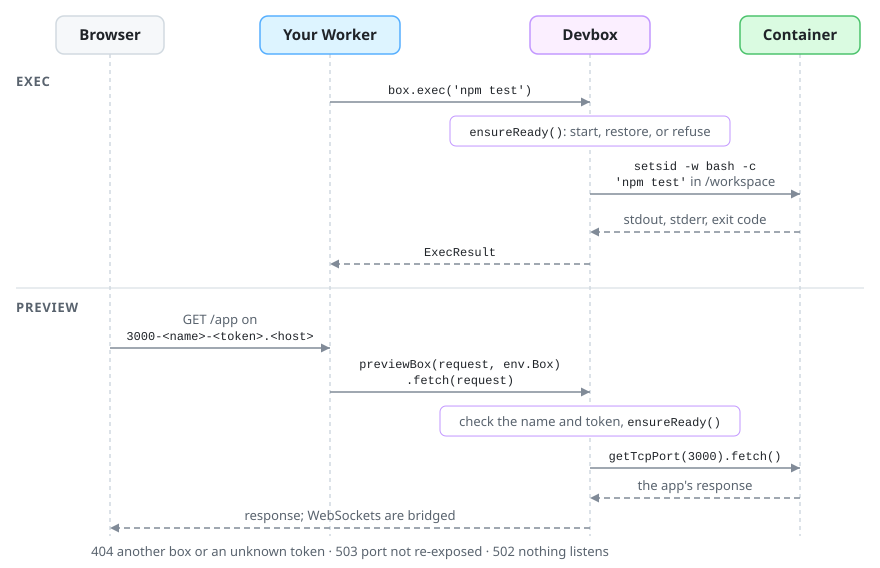

# @kinu.run/devbox

Devbox presents an ephemeral Cloudflare container as a machine that stays: its files survive a recycle, its supervised processes start again, and its preview URLs keep their hostname.

<p align="center"></p>

Every decision in this package, with the measurement that settled it, is in [DEVBOX-DECISIONS.md](../../docs/DEVBOX-DECISIONS.md); the D-numbers below point there. Read it before you change the package.

## A host

The core of [`example/worker.ts`](example/worker.ts), a complete host with no Kinu code:

```ts
import { Devbox } from '@kinu.run/devbox';

export { DevboxGateway } from '@kinu.run/devbox';

interface Env {
  readonly Box: DurableObjectNamespace<ExampleBox>;
}

export class ExampleBox extends Devbox<Env> {}

export default {
  async fetch(request: Request, env: Env): Promise<Response> {
    const box = env.Box.getByName(new URL(request.url).searchParams.get('box') ?? 'example');

    return Response.json(await box.exec('uname -a'));
  },
} satisfies ExportedHandler<Env>;
```

```jsonc
"durable_objects": { "bindings": [{ "class_name": "ExampleBox", "name": "Box" }] },
"migrations": [{ "tag": "v1", "new_sqlite_classes": ["ExampleBox"] }],
"containers": [{ "class_name": "ExampleBox", "scheduling_policy": "durable_object" }],
"r2_buckets": [{ "binding": "DEVBOX_STORE", "bucket_name": "kinu-devbox-example" }]
```

- The store is the R2 bucket bound as `DEVBOX_STORE` (override `store` to name another binding). A box keeps its disk there, and starts from one golden snapshot of `cloudflare/debian-trixie` with the pinned tools installed, built by the box named `GOLDEN_NAME` in the same namespace (D66). Publish the pinned tools to the bucket once: `bun scripts/devbox-tools.ts publish <bucket>`. A box with no bucket bound is refused at its first start, naming the binding (D83).
- The box finds its own namespace among the Worker's exports, the one that accepts its id (D83), so the class must be exported from the Worker.
- The Worker must export `DevboxGateway`. It routes the container's web traffic, and answers its S3 calls from the R2 binding, so no key pair exists (D41).

## Lifecycle

<p align="center"></p>

A box in `repair` still takes calls, so its agent can fix what did not come back. An idle box with a live process records a `rest` incident and holds until `answerRest()`; the default `onIncident` only logs it, so a host that wants the ask overrides `onIncident` (D59). A start that fails the same way every time is refused with code `refused` until its size, internet setting or store binding changes, or a caller calls `start()` or `attachNow()` (D52).

## Durability

<p align="center"></p>

| What comes back | From the snapshot | From the R2 chain |
| --- | --- | --- |
| Files in `/workspace`, `.git` included | as at the last `quiesce()` | as at the last save |
| `archiveExcludes`: `node_modules`, caches, build output | yes | no; an incident names them |
| Supervised processes | restarted, without their memory | restarted, without their memory |
| Exposed ports, with `previewHost` set | same URL | same URL |
| Other processes | no | no |

Only a graceful stop takes a snapshot: `quiesce()`, a running `resize()`, or `answerRest('now')`. `stop()` and `destroy()` save nothing. Snapshots serve for 29 days from the first one in their lineage (D65). A snapshot start that fails or is not admitted within 10 s falls back to a fresh start and the chain; a capacity refusal retries the snapshot instead. The chain's layout and its deltas, merged like a binary counter, are D57 and D77; the block layer is [DEVBOX-BLOCK-LAYER.md](../../docs/DEVBOX-BLOCK-LAYER.md).

## Calls

<p align="center"></p>

`box` is a stub such as `env.Box.getByName('demo')`.

### Start and attach

```ts
await box.start();             // start and restore; returns early while the golden builds
await box.resolveReadiness();  // { kind: 'restored' | 'repair' } or { kind: 'pending', reason }
await box.attachNow();         // retry a refused restore; destroys nothing
```

Commands, files, processes, `exposePort()` and `probePort()` wait on `ensureReady()`, so they start a stopped box. While the golden snapshot builds, `resolveReadiness()` returns `pending` with `building` and those calls refuse; ask again (D79).

### Exec and streaming

```ts
const { stdout, stderr, exitCode } = await box.exec('npm test', { cwd: '/workspace/app' });

const execId = crypto.randomUUID();
const stream = await box.execUntimedStream('npm run build', { execId });
const built = await collectExecRecords(stream, (from, bytes) => console.log(from, bytes.byteLength));
```

Each `execId` launches once; a repeat gets the first answer or `indeterminate`. `killUntimed(execId)` ends its process tree.

### Files

```ts
await box.writeFile('/workspace/app/.env', 'PORT=3000\n');
const { content } = await box.readFile('/workspace/app/.env');
const { files } = await box.listFiles('/workspace/app', { recursive: true });
await box.deleteFile('/workspace/app/dist');
```

`/workspace` is the durable directory and the default `cwd`. A filesystem failure has code `file` and the POSIX code in `cause.code`.

### Background and supervised processes

```ts
const { processId } = await box.startSupervised('npm run dev', '/workspace/app');
await box.stopSupervised(processId);
const job = await box.startProcess('python3 -m http.server 8000');
```

A supervised process has a durable spec, so every start runs it again. A `startProcess` process does not come back.

### Ports and previews

```ts
const { url } = await box.exposePort(3000, { hostname: 'preview.example.com' });
// https://3000-<previewName>-<token>.preview.example.com

// In your Worker, with port and token read from the preview host:
const target = new URL(request.url);
target.pathname = `/_devbox/preview/${port}/${token}${target.pathname}`;
return box.fetch(new Request(target.toString(), request));
```

The token is kept per port. Override `previewHost` and every start re-exposes the port at the same URL. `previewName` defaults to the object id. To pass `token` yourself, take it from `portToken(port)`.

### Resize and sizes

```ts
await box.resize('large');          // a running box saves, stops and starts at the new size
await box.useDefaultSize('small');  // the host's default, used at the next start
```

| `BoxSize` | vCPU | Memory | Disk |
| --- | --- | --- | --- |
| `small` | 1 | 4 GiB | 20 GB |
| `medium` (default) | 2 | 8 GiB | 20 GB |
| `large` | 4 | 12 GiB | 20 GB |

A box starts at its own choice, else its host's default, else the class's `defaultSize` (D50).

### Snapshots and restore

```ts
await box.checkpointNow('tick');   // save changes to the R2 chain now
await box.devboxState();           // ready, unready, chain, snapshot, lastAttach, …
```

`devboxState()` reads and never starts the box.

### Stop

```ts
await box.quiesce();        // drain, save, snapshot, stop
await box.discardState();   // delete the backup
await box.destroy();        // destroy the container; a later call starts it again
```

`quiesce()` waits for calls in flight. It returns `kind: 'failed'` and keeps the box running if a `startProcess` process still runs, the process list cannot be read, or the final save fails (D39, D59).

## API

| Method | What it does | Returns or refuses |
| --- | --- | --- |
| `start()` | Starts and restores; clears a recorded start refusal | `void`, early while the golden builds |
| `kickStartup()` | Arms a start and returns | `void` |
| `resolveReadiness()` | Starts a stopped box, waits for its restore | `restored`, `repair` or `pending`; `refused` when terminal |
| `ensureReady()` | Strict `resolveReadiness()` | `restored` or `repair`; throws on `pending` |
| `restoreStatus()` | Reads the restore | `{ restoring, refused }` |
| `attachNow()` | Retries a refused or partial restore | `AttachOutcome` |
| `exec(command, { cwd, env })` | Runs `bash -c` | `{ stdout, stderr, exitCode }` |
| `execUntimed(command, { execId, cwd, env })` | Runs once per `execId` | `{ stdout, stderr, exitCode }`; `indeterminate` |
| `execUntimedStream(command, { execId, cwd, env })` | The same, streamed | `ReadableStream`; read it with `collectExecRecords` |
| `killUntimed(execId)` | Ends the process tree | `false` if it had already ended |
| `releaseUntimed(execId)` | Forgets the id | `void` |
| `readFile(path, { encoding })`, `readFileStream(path)` | Reads a file | `{ content, encoding }`, `ReadableStream` |
| `writeFile(path, content, { encoding })` | Writes text or a stream; makes parents | `void` |
| `writeFileIfDigest({ path, contentBase64, expected, operation, settled })` | Writes in place only over the bytes whose sha256 is `expected` (`null`: no file); drops the kept answers of `settled` | `{ ok, sha256 }` |
| `mkdir(path, { recursive })`, `deleteFile(path)` | Makes a folder; deletes recursively | `void` |
| `listFiles(path, { recursive })` | Lists a folder | `{ files }` |
| `statFile(path, { follow })`, `exists(path)` | Reads one entry | `{ type, size, mode, … }`, `{ exists }` |
| `startSupervised(command, cwd?)` | Starts a process that every start restores | `{ processId }` |
| `stopSupervised(processId)`, `listSupervised()` | Stops one; lists them | `{ stopped }`, rows |
| `startProcess(command, { cwd, processId })` | Starts a process that is not restored | `{ id, pid, status, … }` |
| `getProcess(id)`, `listProcesses()`, `killProcess(id)` | Native processes | a record or `null`, records, `void` |
| `portToken(port, name?)` | The port's stable token | `{ urlToken }`; `invalid-input` for 6080 |
| `exposePort(port, { hostname, name, token })` | Publishes a port; `token` must come from `portToken()` | `{ port, name, url }`; `invalid-input` for 6080 |
| `getExposedPorts(hostname)` | Lists published ports | `{ port, name, url }[]`; `[]` when stopped |
| `unexposePort(port)` | Revokes a port, also on a stopped box | `void` |
| `probePort(port)` | Asks whether anything answers HTTP | `boolean` |
| `portListeners(stamp, ports?)` | Lists listening sockets and their processes | `PortListener[]`; `null` when stopped |
| `resize(size \| null)` | Sets the box's own size | `ResizeOutcome`; `invalid-input` |
| `useDefaultSize(size \| null)` | Sets the host's default | the size it will start at |
| `boxSize()` | Reads sizes | `{ size, chosen, running, startRefused }` |
| `checkpointNow('tick' \| 'quiesce')` | Saves to the chain | `CheckpointOutcome` |
| `quiesce()` | Graceful stop | `CheckpointOutcome` |
| `answerRest('now' \| 'keep')` | Answers a rest ask | `resting`, `kept`, `refused` or `failed` |
| `stop()` | Stops the container without a save | `void` |
| `discardState()` | Deletes the backup and drops its snapshots (D65) | `void` |
| `destroy()` | Destroys the container without a save and ends the box's starts | `void` |
| `devboxState()`, `devboxIncidentReasons()` | Reads the box and its incidents | a report, incident rows |
| `fetch(request)` | Serves `/_devbox/preview/…`, `/_devbox/terminal` and `/_devbox/desktop` | `Response`; 404 |
| `resetShell()`, `noteTerminalActivity()` | Ends the terminal session; counts terminal use | `void` |
| `ensureGolden()` | Builds the golden snapshot if needed | its snapshot id |

`alarm` and the callbacks it runs (`devboxStartup`, `devboxHeartbeat`, `devboxCheckpoint`, `devboxIncidents`, `devboxGolden`), the peer calls `goldenFor` and `goldenReady`, and `onStop` are public for the platform, peer boxes and subclasses, not for callers.

| Override | Default | Sets |
| --- | --- | --- |
| `store` | `'DEVBOX_STORE'` | the binding of the backup bucket, which also holds the pinned tools |
| `previewHost`, `previewName` | none, the object id | the preview URL |
| `policy` | 60 s heartbeat, 30 min idle, 10 min quiet, 5 min saves, 25 s restore | the lifecycle's timings |
| `defaultSize` | `'medium'` | the size nobody chose |
| `archiveExcludes` | `node_modules`, `*.log`, `.cache`, `.bun`, `__pycache__`, `.venv`, `target`, `.next`, `.turbo`, `dist` | what the chain skips |
| `outboundPolicy()` | `{ routes: {} }` | exact-host routes and a fallback for HTTP on port 80 and HTTPS on 443 |
| `enableInternet` | `true` | raw internet, which other ports use directly; `false` answers unrouted HTTP and HTTPS with 403 |
| `onIncident(incident, delivery)` | logs it | where failures and rest asks go |
| `registry` | `DEVBOX_REGISTRY_TOKEN` and `CLOUDFLARE_ACCOUNT_ID` from the env, when both are set | the Containers token and account that let the box delete dead snapshots (D65) |

Devbox's own failures are `DevboxError`s with a `code` (D42). Worker RPC drops the class, so read a caught one with `devboxFailure({ cause: error })`.

## Kinu's host

`KinuDevbox` ([kinu-devbox.ts](../cf-backend/src/kinu-devbox.ts)) adds the store, previews named after the workspace, incident delivery to the workspace, and Kinu's egress. It also has raw internet (D82) and routes HTTP on port 80 and HTTPS on 443 through the vault. Kinu turns `DevboxError` into its own `KinuError` in one adapter, [sandbox-exec-lane.ts](../cf-backend/src/sandbox-exec-lane.ts).

## Develop

```sh
bun run --cwd packages/devbox test     # Bun and workerd suites
bun run --cwd packages/devbox check    # both TypeScript targets
bun scripts/bench-devbox-standalone.ts # deploys the example, drives one box, deletes everything
```

Devbox depends on `@cloudflare/sandbox`, `effect` and `valibot`, and on no workspace package (`scripts/bench-devbox-independence.test.ts`). The real-container contracts run at the staging deploy tier (`scripts/devbox-container-tier.ts`, D72).
